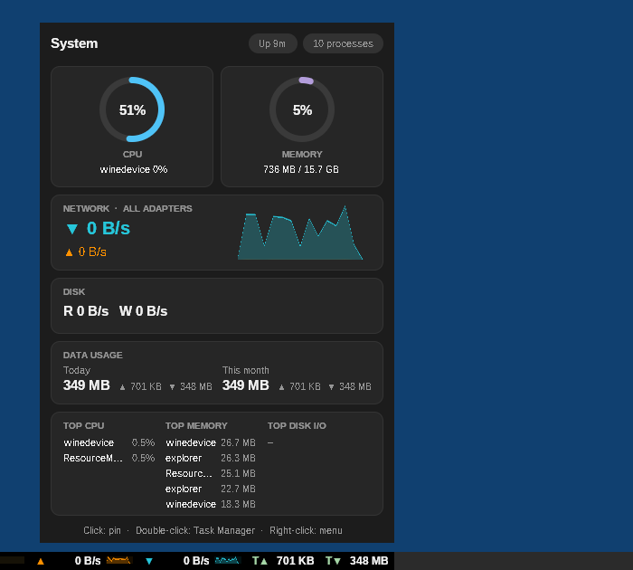
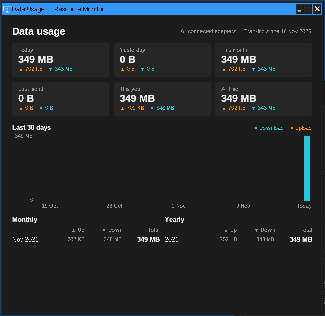

# Resource Monitor

Tiny, native taskbar monitor for Windows 10 and 11. Written in Rust on raw Win32.
No .NET, no driver, no admin rights, no background service.

- **~0.5 MB** single exe, no runtime, no installer required
- **A few MB of RAM**, near-zero CPU (one sample per second, coalesced timers, below-normal priority, EcoQoS)
- Works on current Windows 11 (24H2/25H2) — no WinRing0 / kernel driver that Defender blocks

<p align="center">
  <br>
  
  
</p>

<sub>Screenshots taken from the real app (dark theme). Panel design notes: <a href="docs/ui-reference">docs/ui-reference</a>.</sub>

## What it shows

Docked beside the tray, on the taskbar:

| Metric | Source |
|---|---|
| CPU % (matches Task Manager) | PDH `% Processor Utility` |
| Memory % | `GlobalMemoryStatusEx` |
| GPU % and GPU memory (NVIDIA / AMD / Intel) | PDH `GPU Engine`, same as Task Manager |
| Disk read / write / active time | PDH `PhysicalDisk` |
| Upload / download speed | `GetIfTable2` 64-bit counters |
| Data used today | exact byte counters, saved per day |
| Top process | `NtQuerySystemInformation` |
| Battery | `GetSystemPowerStatus` |

Pick any combination from **right-click → Metrics**. Default: CPU, RAM, GPU, ▲, ▼, today's download.

## Smart overlay

- **Auto-docks** next to the tray. Follows the taskbar: bottom, top, left, right, any DPI, small/large taskbar, Explorer restarts.
- **Multi-monitor**: a widget on every taskbar, or only the ones you pick (right-click → *Displays*). Needs Windows' "Show my taskbar on all displays". Each display keeps its own drag position; mixed DPI is handled per monitor.
- **Fits the taskbar**: 1, 2 or 3 rows depending on taskbar height; related metrics (▲/▼, CPU/RAM) stay paired; widths never jitter.
- **Hides itself** for full-screen games, videos and presentations — only on the monitor that's full-screen — and when an auto-hide taskbar slides away.
- **Stays on top** of the Windows 11 taskbar (re-asserted on focus change, no polling).
- **Hover** → details panel: ring gauges for CPU / memory / GPU, live network and disk charts, data usage (today, month, cap), uptime, battery, top 5 processes by CPU, memory and disk I/O.
- **Click** → pin the panel. **Double-click** → Task Manager. **Drag** → move along the taskbar (or anywhere in floating mode).
- **Theme-aware**: matches light/dark taskbar; values turn amber/red past thresholds (default 75% / 90%).
- **Sensors your PC lacks are hidden** automatically (no GPU counter → no GPU row; no battery → no battery row).
- **Display off** → samples every 5 s. Data usage stays exact anyway (cumulative counters).

## Data usage

- Counted from interface byte counters, so totals are exact regardless of the update interval.
- Physical adapters only — no double counting through VPN/filter/virtual adapters. Or choose one adapter.
- **Report** (right-click → *Data usage report*, double-click the tray icon, or `ResourceMonitor.exe --report`):
  today, yesterday, this/last month, year, all time, last-30-days chart, monthly and yearly tables.
- **Monthly data cap**: set `data_cap_gb` and `cap_reset_day` in the settings file → progress bar, and the widget turns amber/red as you approach it.
- Stored in `%LOCALAPPDATA%\ResourceMonitor\usage.csv` (plain CSV, atomic writes, saved every minute and on sleep/shutdown).

## Install

1. Download `ResourceMonitor.exe` (portable) or `Setup_ResourceMonitor.exe` (per-user install, no admin) from [Releases](../../releases).
2. Run it. Right-click the widget or tray icon → **Start with Windows**.

Upgrading from the old .NET version: settings and data usage history are imported automatically on first run, and the old autostart entry is removed.

## Settings

Most options are in the right-click menu. Everything is also in `%LOCALAPPDATA%\ResourceMonitor\settings.ini` (menu → *Edit settings file*); edits apply within a few seconds.

| Key | Meaning |
|---|---|
| `show.<metric> = 1/0` | cpu, ram, gpu, vram, disk_read, disk_write, disk_active, net_up, net_down, today_up, today_down, top_process, battery |
| `speed_unit` | `auto`, `autobits`, `KB/s`, `MB/s`, `Kbps`, `Mbps` |
| `adapter` | empty = all physical adapters, or a name such as `Wi-Fi` |
| `interval_ms` | 250–10000 |
| `mode` | `dock` or `float` |
| `dock_offset` | gap from the tray on the main taskbar (set by dragging) |
| `displays` | `primary`, `all`, or a list such as `DISPLAY1,DISPLAY3` |
| `dock_offset.DISPLAY2` | gap from the clock on another monitor's taskbar |
| `hide_fullscreen`, `click_through` | 1/0 |
| `text_scale` | 70–200 (%) |
| `theme` | `auto`, `dark`, `light` |
| `bg_opacity` | 0 (invisible) – 255 (solid) |
| `warn_pct`, `crit_pct` | colour thresholds |
| `data_cap_gb`, `cap_reset_day` | monthly cap (0 = off) and billing day |

## Build

```bash
cargo build --release
```

Output: `target\release\ResourceMonitor.exe`. `publish.bat` also builds the installer when Inno Setup (`ISCC`) is on PATH. CI builds both on every push and attaches them to `v*` tags.

## What changed from 1.x

The .NET/WPF app was rewritten from scratch. Fixed along the way:

- Required admin + a kernel driver (LibreHardwareMonitor/WinRing0), now blocked by Windows Defender's vulnerable-driver list → replaced by user-mode APIs.
- 100 ms timer forcing z-order and position 10×/s → event-driven, 1 sample/s.
- Data usage summed rounded per-second *speeds* (drifted, and double-counted virtual adapters) → exact byte counters.
- Overlay covered full-screen games → auto-hides.
- Tray icon vanished after Explorer restarts → re-created.
- Prompted to "install" itself on every launch from a different folder → gone; plain portable exe.
- Overlay position broke with DPI scaling, top/side taskbars, auto-hide → handled.
- 70 MB self-contained .NET bundle → ~0.5 MB.

## License

MIT — see [LICENSE](LICENSE).
